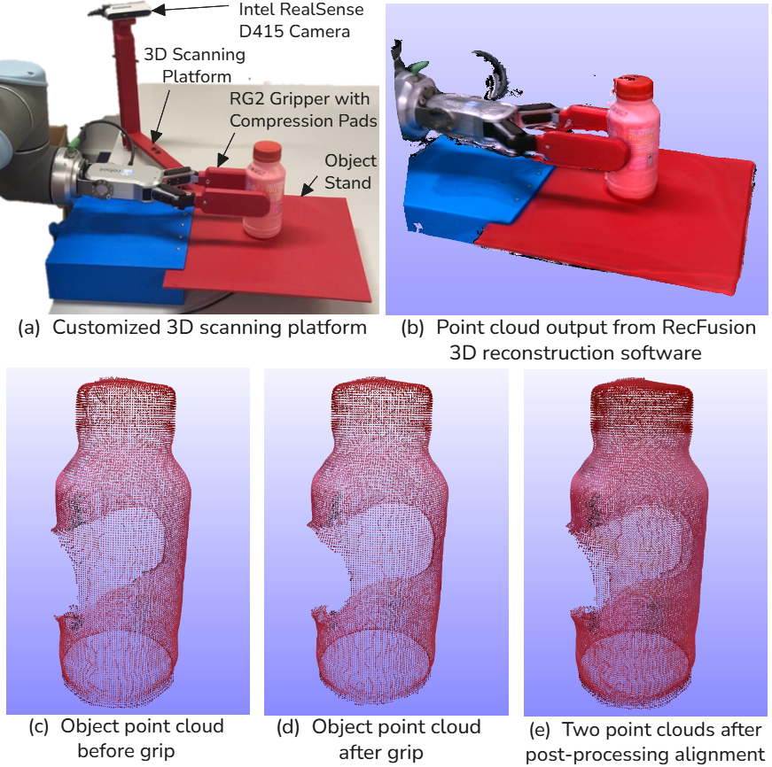

# Object Deformability Score Calculation

This repository provides the experimental methodology and processing
scripts used to quantify object deformation before and after robotic
grasping using the Density-Aware Chamfer Distance (DCD).

The workflow involves 3D mesh reconstruction using RecFusion,
point-cloud preprocessing, coarse alignment using MeshLab,
and fine registration using the Iterative Closest Point (ICP) algorithm.

The resulting aligned point clouds are used to calculate DCD,
providing a quantitative measure of object deformation.

## 1. 3D Mesh Reconstruction Using RecFusion

RecFusion is used to reconstruct the 3D geometry of objects before
and after robotic grasping.

### Step 1: Install RecFusion

1. Download RecFusion from the official website:
   https://www.recfusion.net/
2. Install RecFusion following the official installation instructions.
3. Connect a compatible depth camera to the computer.
4. Launch RecFusion and verify that the camera is detected.

### Step 1: Install RecFusion

1. Download RecFusion from the official website:
   https://www.recfusion.net/

2. Install RecFusion following the official installation instructions.

   <p align="center">
     
   </p>

3. Use the 3D scanning platform to reconstruct the 3D geometry of each object by moving the camera around the object to capture its geometry from multiple viewpoints.
   
5. Export the reconstructed 3D mesh in PLY format.
6. Repeat the procedure after before and after grasping each object to capture the meshes.

Two reconstructed meshes are obtained for each object:

- **Before grasping:** Reference object geometry.
- **After grasping:** Deformed object geometry.

## 2. Install Prerequisites

Python 3 is required for point-cloud processing and alignment.

First, clone this repository:

```bash
git clone https://github.com/Moni9612/Object-Deformability-Score-Calculation.git
```

Navigate to the repository:

```bash
cd Object-Deformability-Score-Calculation
```

Navigate to the DCD implementation folder:

```bash
cd Density_aware_Chamfer_Distance
```

Create a Python virtual environment:

```bash
python3 -m venv .venv
```

Activate the environment:

```bash
source .venv/bin/activate
```

Install the required dependencies:

```bash
python3 -m pip install -r requirements.txt
```

The DCD implementation and supporting scripts are available in:

[Density_aware_Chamfer_Distance](./Density_aware_Chamfer_Distance/)

Additional environment configuration may be required depending
on the installed Python, PyTorch, and CUDA versions.

## 3. Point-Cloud Format Conversion

The reconstructed meshes exported from RecFusion must be prepared
in the appropriate point-cloud format before registration.

The following Python script is provided for this purpose:

[binary_ascii.py](./Density_aware_Chamfer_Distance/binary_ascii.py)

Navigate to the DCD directory:

```bash
cd Density_aware_Chamfer_Distance
```

Execute the conversion script:

```bash
python3 binary_ascii.py
```

Apply the conversion procedure to both the before-grasping and
after-grasping reconstructed data.

The resulting point clouds are used for subsequent alignment.

## 4. Coarse Alignment Using MeshLab

Before applying ICP, the reference and deformed point clouds
must be approximately aligned.

### Step 1: Install MeshLab

Download and install MeshLab:

https://www.meshlab.net/

### Step 2: Perform Coarse Alignment

1. Open MeshLab.
2. Import the before-grasping and after-grasping point clouds.
3. Open the alignment tool.
4. Select the reference and moving point clouds.
5. Perform approximate registration using corresponding points.
6. Visually inspect the alignment.
7. Export the coarsely aligned point clouds.

This step provides an initial transformation to improve
the convergence of the subsequent ICP registration.

## 5. Fine Alignment Using ICP

Following coarse alignment, the Iterative Closest Point (ICP)
algorithm is applied to refine the registration between
the reference and deformed point clouds.

The implementation is available in:

[icp_alignment.py](./Density_aware_Chamfer_Distance/icp_alignment.py)

Execute the script:

```bash
python3 icp_alignment.py
```

ICP iteratively minimizes the geometric distance between
corresponding points to refine the alignment.

The resulting registered point clouds are subsequently
used for Density-Aware Chamfer Distance calculation.

## 6. Density-Aware Chamfer Distance (DCD)

After ICP registration, the aligned before-grasping and
after-grasping point clouds are used to calculate DCD.

The following Python script is provided for this purpose:

[dcd_bench.py](./Density_aware_Chamfer_Distance/dcd_bench.py)

Navigate to the DCD directory:

```bash
cd Density_aware_Chamfer_Distance
```

Execute the conversion script:

```bash
python3 dcd_bench.py
```
